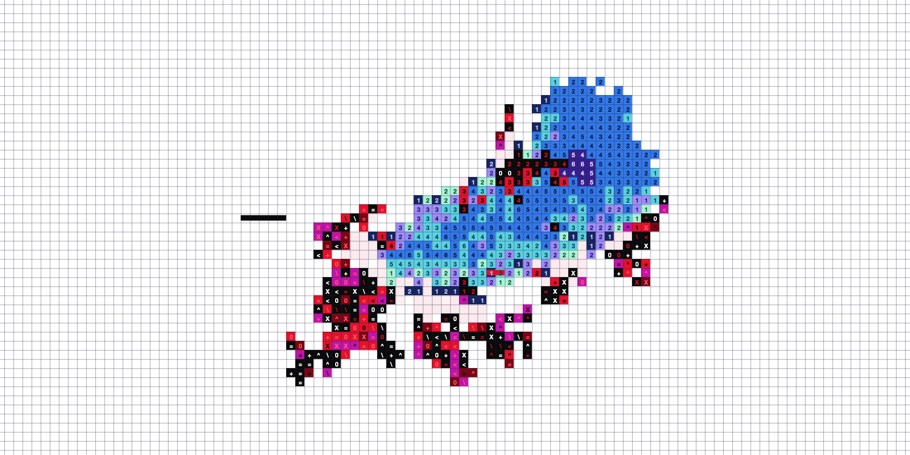

<h1 align="center">Number Snake</h1>

  A grid of numbered cells with something alive on it. 
  Two defenders hunt glitching red-and-black infections, and nothing they do is scripted.

  <a href="https://kassem-kanjo.github.io/number-snake/"><b>Play it in your browser</b></a>
  &nbsp;·&nbsp;
  <a href="https://github.com/kassem-kanjo/number-snake/releases/latest"><b>Mac app and screensaver</b></a>

  

## The cast

**The hunter** is the blue one. It wanders, dozes, patrols, and when it catches the scent of an infection it stops, stalks, coils and lunges. Under enough pressure it splits in two.

**The warden** is the teal one, calm and deliberate. It circles an infection to pen it in, then crushes it.

**Infections** are the red-and-black glitches. Every one is born different, and none of them can win, though some put up a fight.

## Nothing is scripted

There are no enemy types and no attack animations. Every infection rolls its own value for each of these, independently, so any mixture can turn up:

| Trait | What it does | How you can tell |
|---|---|---|
| **greed** | How much of the grid it could ever cover | Redder, and it keeps coming |
| **growth** | How fast it spreads | Redder |
| **armour** | Extra layers on its cells; each bite strips one | Near-solid black |
| **spite** | Hits back when bitten: throws the defender off and lashes out | White sparks, torn edges |
| **nerve** | Backs away from a defender, until it tires | Flickers fast |
| **tips** | Grows as a lump or as tendrils | Its shape |
| **lure** | Grows toward the defenders, or away from them | Which way it leans |
| **drive** | Creeps steadily in one direction | It travels |
| **spore** | Throws off children that land elsewhere with mutated traits | Red dots arcing across the grid |
| **hush** | Hides its scent, so it is noticed late | Dark and slow to flicker |
| **venom** | Poisons whatever eats it, slowing it down | Magenta cells |

The defenders work the same way. Each attack is a plan rolled fresh: how much to circle, how close to creep, how long to coil, how hard to strike, how wide to open. A lunge from ambush, a string of quick bites and a slow engulfing are all the same code with different numbers. Between hunts their mood drifts, so they rest, roam, and go back to nose around where they last fed.

Hover anything on the grid to read it: an infection's traits, or what a defender is doing and how it feels.

## Reading the grid

- **The numbers** on a defender count down each cell's remaining life, 8 to 1. The body reads like a contour map.
- **The dark patch** inside the hunter is its nucleus. It leans toward whatever has its attention, so you can see it notice something before it moves.
- **A fresh trail is a wall.** Infections cannot grow or retreat through it.
- **Faint pink** marks where something was just eaten.

## Controls

The controls hide in the small dot at the bottom of the window. Hover it.

| | |
|---|---|
| Hold the mouse | Steer the hunter |
| Double-click | Drop an infection |
| Hover | Inspect anything |
| **Outbreak** | Switch from the calm default to more, bigger, faster infections |
| **Hunter** / **Warden** | Take a defender off the grid, or put it back |
| **Record** | Save a video clip |
| `Space` · `R` · `F` | Pause · restart · fullscreen |

Every run has a number, shown as a link in the panel. Open the link and the same run plays again.

## Get it

- **Browser:** [kassem-kanjo.github.io/number-snake](https://kassem-kanjo.github.io/number-snake/). Nothing to install.
- **Mac app and screensaver:** on the [latest release](https://github.com/kassem-kanjo/number-snake/releases/latest). They are not notarised by Apple, so macOS warns the first time; [mac/README.md](mac/README.md) shows the way through.
- **From source:** it is one file. Download the repo and open `index.html`.

## Under the hood

One HTML file, no dependencies, no build step. `node bench.js` runs the simulation without a browser and checks that every outbreak still gets cleared; it runs on every pull request.

- [How the code is organised](docs/ARCHITECTURE.md)
- [What was decided, and what was tried and thrown away](docs/DECISIONS.md)
- [How changes are made and checked](CONTRIBUTING.md)
- [Changelog](CHANGELOG.md)

## Credit

The idea started from a grid animation by Antonin Waterkeyn, seen in a [post by Figs From Plums](https://x.com/FigsFromPlums/status/2108195710210396426). All code here was written for this project. [MIT licence](LICENSE).
